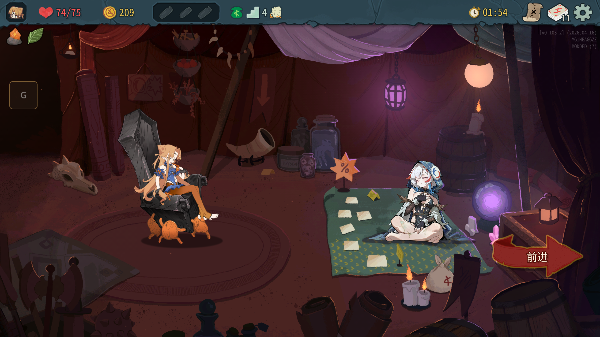
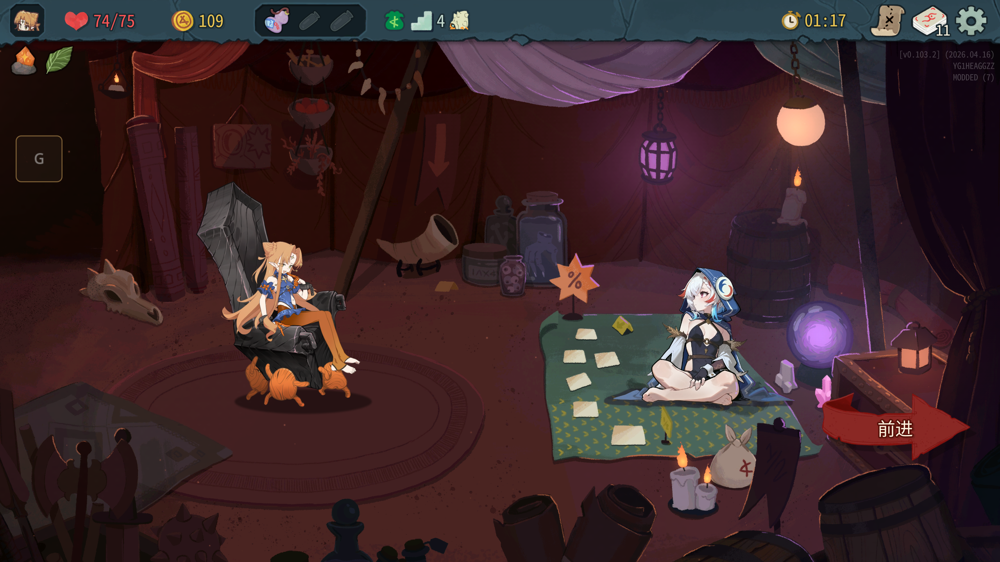
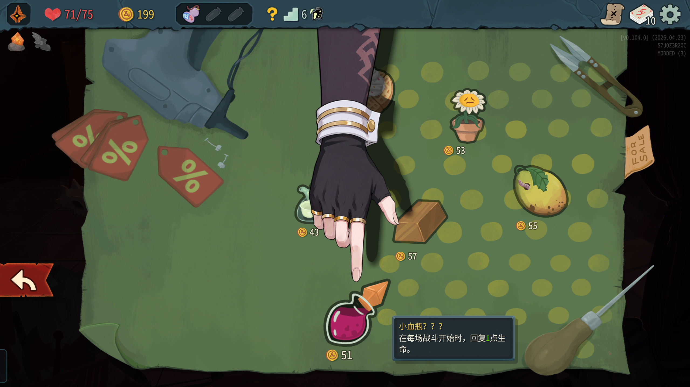
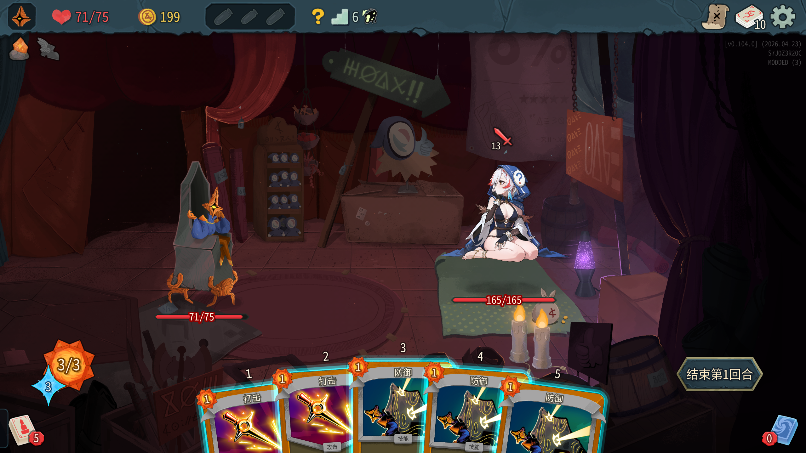
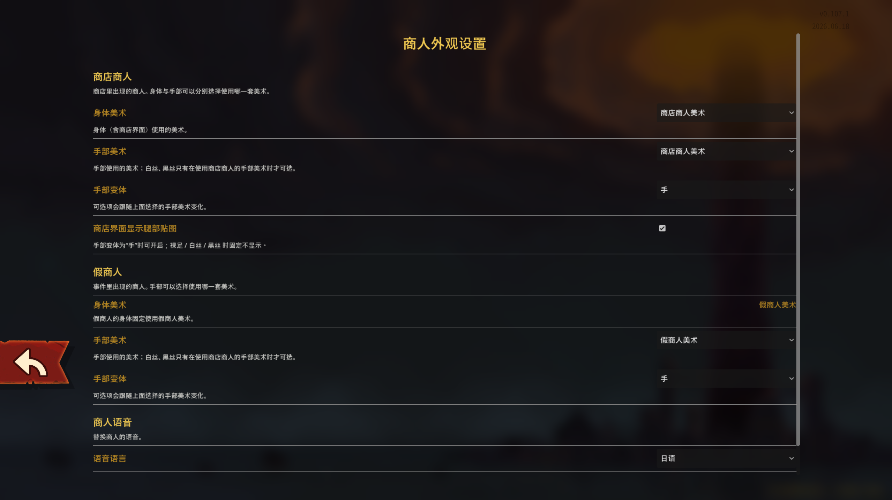

# [STS2 mod] Merchant 2 Cute II


[English](README.md) · [简体中文](README.zh-CN.md)

A texture-replacement mod for **Slay the Spire 2** that turns the merchant (and the reverse merchant) into a cute girl — new Spine art, mix-and-match body/hand sets, and fully replaced voice lines. No gameplay changes.

Artwork was AI-generated and then edited by hand.

## Preview

**Shop merchant**





**Reverse merchant / event & battle**





## Features

- **Texture replacement only** — merchant art is swapped, gameplay logic is untouched (gold rewards, the reverse merchant's fight transition, dialogue and screen shake all stay vanilla).
- **Body / hand sets can be mixed** — pick which art set the body uses and which the hands use, independently, for each merchant.
- **Hand variants** — `hand` / `barefoot` / `white stockings` / `black stockings`. Which variants are available follows the hand art you picked.
- **Shop leg texture** — an extra leg image in the shop UI. It only appears together with the `hand` variant and can be toggled on/off (default **on**).
- **Voice replacement** — vanilla / Japanese / Chinese, with a volume slider (−12 ~ +12 dB). Covers both merchants, including the reverse merchant's laugh and the "thank you" line after a Foul Potion.
- **Legacy config migration** — old `merchant2cute_config.json` is migrated automatically, and legacy key names are still written so downgrading stays safe.
- **Version tolerant** — no minimum game version is declared; version differences only select a code path (verified on 0.107.1 and 0.111.0).

## In-game settings

`Settings → Game Settings → 「商人外观」 → 打开设置` opens a full settings page (not a popup), with the same layout as the vanilla settings screen. Changes apply immediately.



Per merchant you can set **body art**, **hand art** and **hand variant**; the voice section holds language and volume. Everything is stored in `merchant2cute_config.json` under the user data directory, and can also be changed from the console.

## Installation

1. Download the archive from [Releases](https://github.com/LinXce/merchant-2-cute-ii/releases).
2. Extract it into `Slay the Spire 2/mods/` (create the folder if it does not exist).
3. Launch the game. If you prefer not to use the console, edit `merchant2cute_config.json` in the user data directory instead.

Requirements: Slay the Spire 2 **0.107.1 ~ 0.111.x**. No other mods are required.

## Console commands

Press `` ` `` to open the console.

```
merchant status                       # current settings for both merchants
merchant real|fake body  <own|other>   # body art set (reverse merchant is fixed to its own)
merchant real|fake hand-set <own|other>
merchant real|fake hand  <hand|foot|white|black|toggle>
merchant real|fake leg   <on|off|toggle>
merchant voice <default|jp|zh|toggle|db <value>>
merchant tune                        # fine-tune the visual offset/scale, per merchant × art set
```

## Compatibility

| Game version | Result |
|---|---|
| 0.107.1 | tested ✔ |
| 0.111.0 | tested ✔ |
| 0.109.x | expected to work (between the two compatibility thresholds) |

Compatibility is handled with capability flags — a couple of version thresholds decide *which branch* runs, never *whether the mod loads*. Every patch also binds arguments positionally, so renamed parameters cannot break it.

## Changelog

**v1.6.0**

- Settings rework: body and hand art can be mixed across sets, per merchant.
- New settings page inside the vanilla settings screen, following the game's theme and wording.
- Voice replacement now covers both merchants and both audio entry points.
- Leg texture rule: only with the `hand` variant, toggleable, default on.
- Reverse merchant body art is locked to its own set.

## License

[GNU General Public License v3.0](LICENSE.txt)
