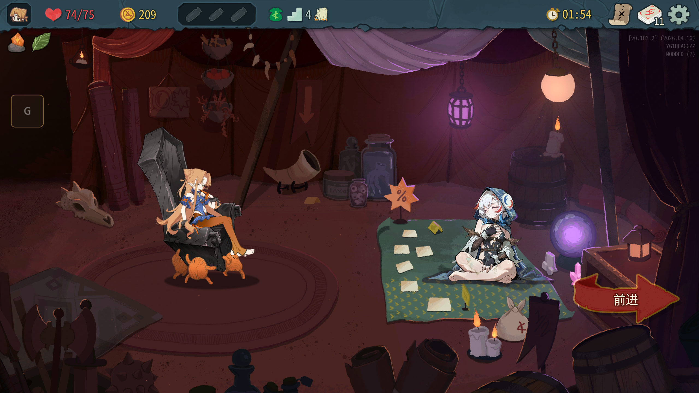
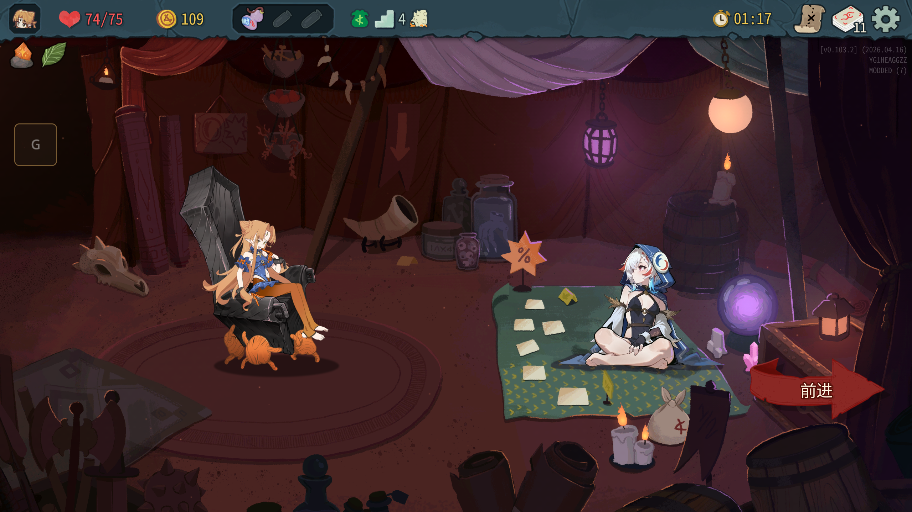
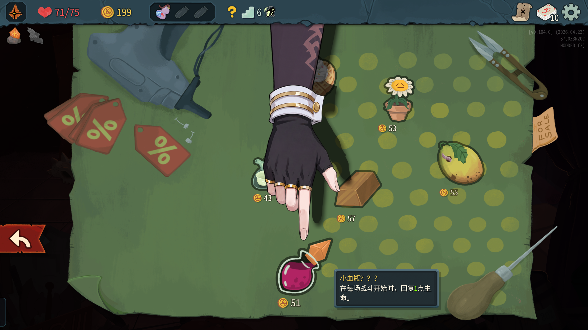
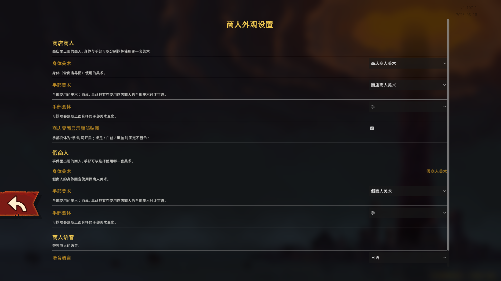

# [STS2 mod] 商人娘化mod2


[English](README.md) · [简体中文](README.zh-CN.md)

**杀戮尖塔 2** 的贴图替换 mod：把商人（以及假商人）换成可爱的女孩子——重制 Spine 美术、身体与手部可跨套混搭、语音整段替换。不修改任何玩法逻辑。

贴图基于 AI 生成，之后经过人工修改。

## 预览

**商店商人**





**假商人 / 事件与战斗**




## 功能

- **只替换贴图**——商人美术换掉，玩法逻辑一律不动（给金币、假商人转战斗、台词气泡、屏幕震动都是原版行为）。
- **身体 / 手部可各自选来源**——两个商人分别设置，身体用一套、手部用另一套也可以。
- **手部变体**——`手` / `裸足` / `白丝` / `黑丝`；可选范围跟随你选择的手部美术。
- **商店腿部贴图**——商店界面额外的一张腿部图，只手部变体为「手」时出现，可单独开关（**默认开启**）。
- **语音替换**——原版 / 日语 / 中文，带音量滑条（−12 ~ +12 dB）。两个商人都覆盖，包括假商人的笑声和丢污浊药水后的感谢语。
- **配置自动迁移**——旧版 `merchant2cute_config.json` 自动升级，并继续回写旧字段名，降级回旧版本也安全。
- **版本宽容**——不声明最低游戏版本；版本差异只决定走哪条代码分支（0.107.1 与 0.111.0 均已实测通过）。

## 游戏内设置

`设置 → 游戏设置 → 「商人外观」 → 打开设置`，打开的是**整页设置界面**（不是弹窗），排版跟随原版设置页，改动即时生效。



每个商人可以分别设置**身体美术**、**手部美术**、**手部变体**；语音分组里是语言和音量。所有设置保存在用户数据目录下的 `merchant2cute_config.json`，也可以直接用控制台修改。

## 安装

1. 从 [Releases](https://github.com/LinXce/merchant-2-cute-ii/releases) 下载压缩包。
2. 解压到 `Slay the Spire 2/mods/`（没有 `mods` 文件夹就手动创建）。
3. 启动游戏。不想用控制台的话，直接在用户数据目录里改 `merchant2cute_config.json` 也可以。

适用版本：杀戮尖塔 2 **0.107.1 ~ 0.111.x**，不需要其它 mod。

## 控制台命令

按 `` ` `` 打开控制台。

```
merchant status                       # 查看两个商人的当前设置
merchant real|fake body  <own|other>   # 身体美术来源（假商人的身体固定为本套）
merchant real|fake hand-set <own|other>
merchant real|fake hand  <hand|foot|white|black|toggle>
merchant real|fake leg   <on|off|toggle>
merchant voice <default|jp|zh|toggle|db <值>>
merchant tune                        # 按「商人 × 美术来源」微调位置/缩放
```

## 版本兼容

| 游戏版本 | 结果 |
|---|---|
| 0.107.1 | 已实测 ✔ |
| 0.111.0 | 已实测 ✔ |
| 0.109.x | 预期可用（位于两个兼容阈值之间） |

兼容通过"能力位"实现：两个版本阈值只决定**走哪条分支**，不决定**能否加载**；补丁全部按位置绑定参数，改参数名不会失效。

## 更新记录

**v1.6.0**

- 设置系统重做：身体与手部可跨美术套混搭，按商人分别设置。
- 新的设置界面放进原版设置页，配色与措辞跟随游戏。
- 语音替换覆盖两个商人、两个音频入口。
- 腿部贴图规则：仅手部变体为「手」时生效，可开关，默认开启。
- 假商人的身体美术固定为本套。

## 许可证

[GNU General Public License v3.0](LICENSE.txt)
